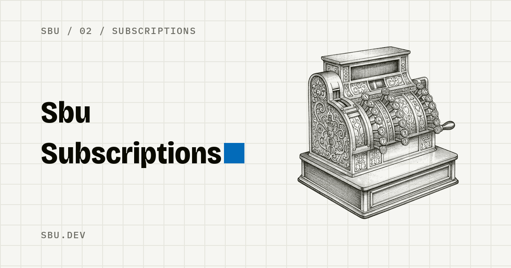

# sbu-apps

Free iOS apps and games from [sbu.dev](https://sbu.dev). Each app remakes a single paid utility from the top of the App Store, each game one of the most played free games without its ads: no subscription, no in-app purchases, no account, no ads, no tracking, data only on the device. sbu.dev's third branch, [Software](https://sbu.dev/software), remakes enterprise software as open source; its first project, Sbu Commerce, lives in its own repo.

**On the App Store:** [Sbu Subscriptions](https://apps.apple.com/app/id6780154928), a free alternative to Orbit, and [Sbu Scanner](https://apps.apple.com/app/id6772572337), QR codes and barcodes without ads. One new app a week; the rest are below.

<p>
  <a href="https://sbu.dev/en/apps/subscriptions"></a>
  <a href="https://sbu.dev/en/apps/scanner"></a>
</p>

Native SwiftUI, one shared design system (`Packages/SbuKit`), Italian and English, iOS 17+. The apps depend only on Apple frameworks: no third-party code, no analytics, no network. MIT licence.

```
Design/            design system snapshot: tokens.json, icons, logos, fonts
Packages/SbuKit/   SwiftUI package: SbuTheme tokens, components, app shell
Apps/Sbu<Name>/    one XcodeGen project per app, with fastlane
Tools/             discover, spec, icons, token sync, new app scaffold
Site/              sbu.dev: Astro + Tailwind, app text read from each app's fastlane metadata
.claude/skills/    Swift agent skills to load before writing Swift (see CLAUDE.md)
```

Design system: https://claude.ai/artifact/A9vJiSmn34wgxe9ePFHLfA

## Setup, once

```sh
brew install xcodegen fastlane
python3 -m venv .venv && .venv/bin/pip install -r Tools/requirements.txt
export ANTHROPIC_API_KEY=...   # only for Tools/spec.py
```

Xcode 26 with an iOS simulator runtime (`xcodebuild -downloadPlatform iOS`).

## Add an app in 5 commands

```sh
python3 Tools/discover.py                           # 1. top-paid IT + US -> research/<app-id>/meta.json + screenshots
.venv/bin/python Tools/spec.py 357421934            # 2. listing + screenshots + 1-3★ reviews -> research/<app-id>/spec.json
Tools/new_app.sh Noise accent-noise noise           # 3. Apps/SbuNoise: project, dev.sbu.noise, SbuKit, icon, fastlane
cd Apps/SbuNoise && fastlane test                   # 4. build the app from spec.json, run the tests
fastlane snapshot && fastlane frames && fastlane beta    # 5. App Store screenshots, panorama (Tools/make_screenshots.py), TestFlight
```

Between 3 and 4 you write the app: start from `MainView.swift`, put strings in `Localizable.xcstrings` (Italian source, English translation), and fill the placeholders in `fastlane/metadata/{it,en-US}`. `new_app.sh` arguments: an English noun, an `accent-*` token not used by a nearby category, and the instrument the icon engraves, in English (needs `GEMINI_API_KEY`).

`new_app.sh` also creates the App Store Connect record when `FASTLANE_USER` (Apple ID) is set: the API key cannot create apps, so `fastlane create_app` logs in with the Apple ID, 2FA once, then the cached session. `fastlane release` uploads build, metadata and framed screenshots without submitting. `beta` and `release` read `ASC_KEY_ID`, `ASC_ISSUER_ID`, `ASC_KEY_PATH` and `SBU_TEAM_ID`.

## Tools

| | |
|---|---|
| `sync_tokens.py` | Regenerates SbuKit colors (asset catalog, light/dark), metrics and `Site/src/styles/tokens.css` from `Design/tokens.json`. CI fails if they drift. |
| `make_icons.py` | `<name>` → engraved icon `Design/icons/sbu-<name>.png` from `engravings.json` and `source/`; `--generate` draws a new engraving with Gemini, `--appiconset`/`--artwork` write light, dark and tinted variants. |
| `make_og.py` | Link previews (1200×630) for the site: each app's name closed by its full stop beside its engraving, and the home's title per locale, into `Site/public/og/`. Rerun after a new engraving. |
| `discover.py` | Top-paid charts (Apple marketing RSS) + iTunes Lookup: description, screenshots, price, release notes, genre. |
| `spec.py` | Claude (`claude-opus-5-5`, vision, structured output) → `features[]`, `screens[]`, `flows[]`, `data_model`, `monetization`, `user_pains[]`. |
| `new_app.sh` | Scaffolds `Apps/Sbu<Name>` from `Tools/templates/app` and its site entry `Site/src/content/apps/<name>.md`. |

Specs come only from public App Store data. Nothing here decompiles or extracts assets from other apps.

## Apps

| App | Accent | Remakes | Status |
|---|---|---|---|
| [Sbu Subscriptions](Apps/SbuSubscriptions) | `accent-subscriptions` | Orbit | [App Store](https://apps.apple.com/app/id6780154928) |
| [Sbu Scanner](Apps/SbuScanner) | `accent-scanner` | QR Reader for iPhone | [App Store](https://apps.apple.com/app/id6772572337) |
| [Sbu Find](Apps/SbuFind) | `accent-find` | Find Air | In App Review |
| [Sbu Habits](Apps/SbuHabits) | `accent-habits` | Streaks | In App Review |
| [Sbu Noise](Apps/SbuNoise) | `accent-noise` | White Noise | In App Review |
| [Sbu Speed](Apps/SbuSpeed) | `accent-speed` | Speedometer 55 Pro. GPS kit. | TestFlight |
| [Sbu Moon](Apps/SbuMoon) | `accent-moon` | My Moon Phase Pro | In App Review |
| [Sbu Clean](Apps/SbuClean) | `accent-clean` | Cleanup | In App Review |
| [Sbu Chats](Apps/SbuChats) | `accent-chats` | The Cringe: Chat Wrapped | TestFlight |
| [Sbu Fuel](Apps/SbuFuel) | `accent-fuel` | Fuelly: MPG & Service Tracker | TestFlight |
| [Sbu Inventory](Apps/SbuInventory) | `accent-inventory` | Sortly | TestFlight |
| [Sbu Shrink](Apps/SbuShrink) | `accent-shrink` | Compress Videos & Resize Video | In development |
| [Sbu Grid](Apps/SbuGrid) | `accent-grid` | DrawinGrid | In development |
| [Sbu Tidy](Apps/SbuTidy) | `accent-tidy` | Tody | In development |
| [Sbu Libretto](Apps/SbuLibretto) | `accent-libretto` | — | In development |
| [Sbu Squares](Apps/SbuSquares) | `accent-squares` | Block Blast! (game, without its ads) | In development |
| [Sbu Sudoku](Apps/SbuSudoku) | `accent-sudoku` | Sudoku (game, without its ads) | In development |
| [Sbu Meds](Apps/SbuMeds) | `accent-meds` | Medisafe | In development |
| [Sbu Remote](Apps/SbuRemote) | `accent-remote` | TV Remote - Universal Control | In development |
| [Sbu Level](Apps/SbuLevel) | `accent-level` | Clinometer + bubble level | In development |

Live, in review and coming apps, with their pages: [sbu.dev](https://sbu.dev).

## Site

`cd Site && npm install && npm run dev`. Pages are built from `src/content/apps/*.md` (accent, store id, Originale, FAQ) joined with `Apps/*/fastlane/metadata/{it,en-US}` (name, subtitle, description). An app with a content file but no listing yet gets no page: it shows on the home as "In arrivo" with the `teaser` line from its content file. Set `status: live` and `appStoreId` when an app is on the App Store; its `alternatives/<it|en>/<originale>.md` page is built only then and with `draft: false`. `SBU_DRAFTS=1 npm run build` builds drafts too. Strategy in `docs/marketing/`.
